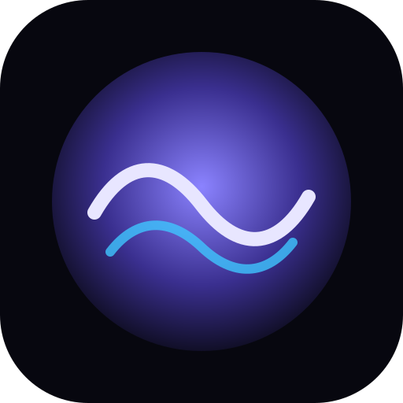
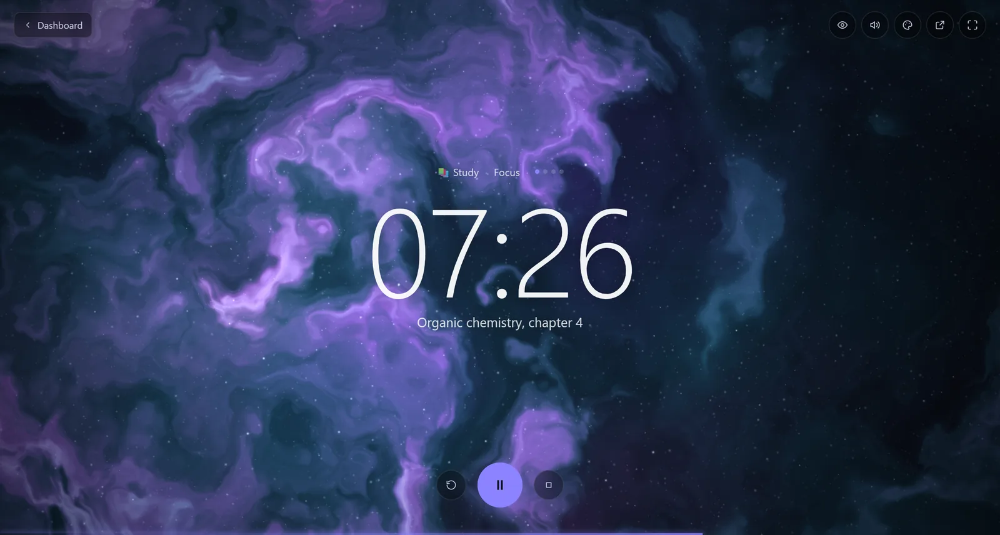
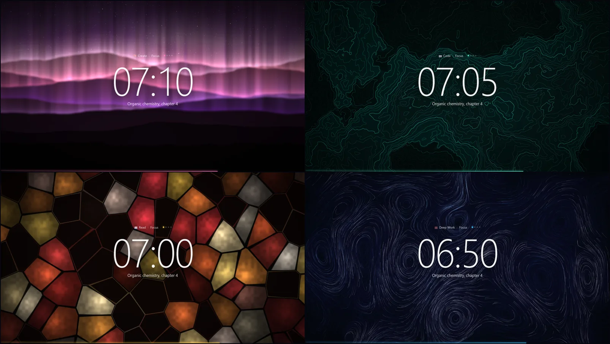
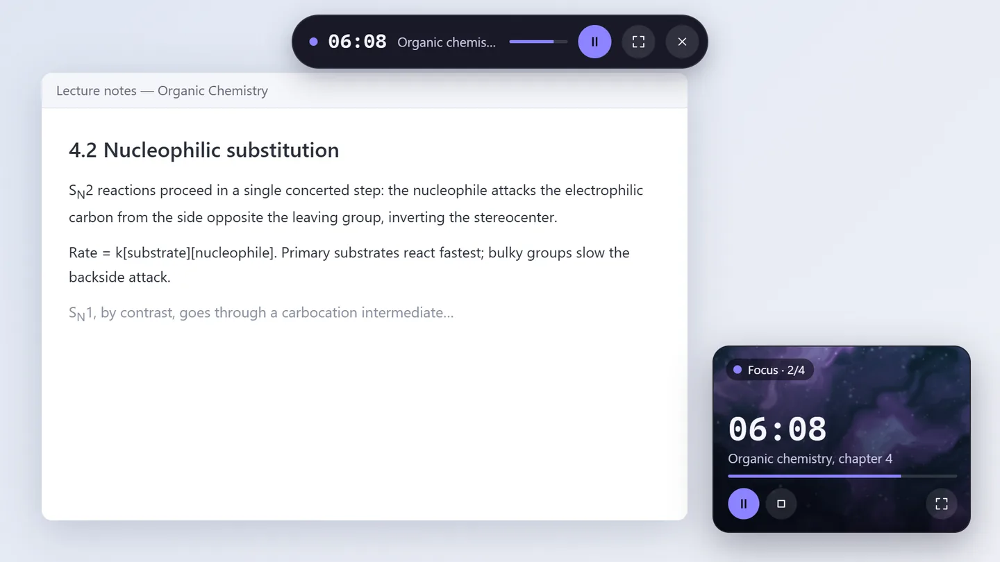
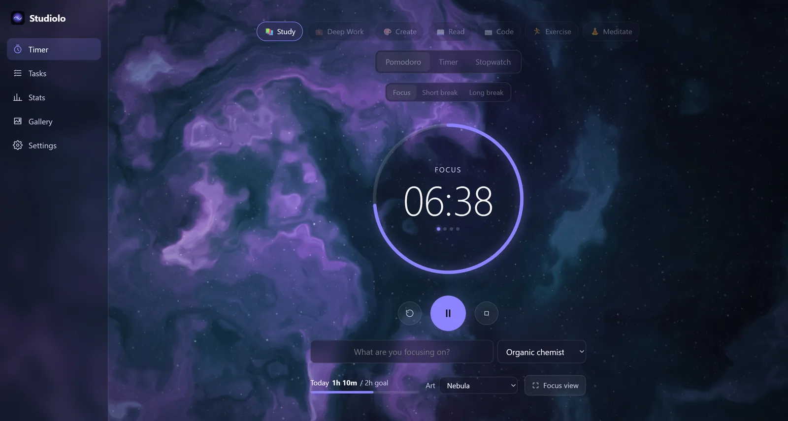
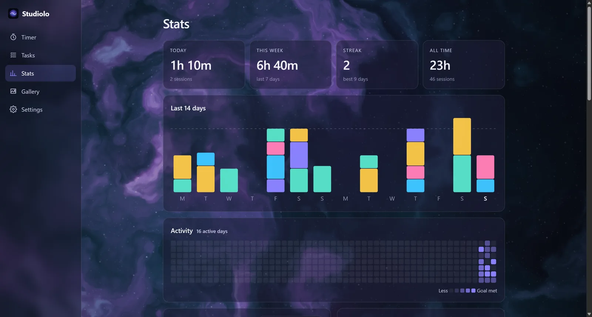

<p align="center">
  
</p>

<h1 align="center">Studiolo</h1>

<p align="center">
  <strong>A focus timer that paints while you work.</strong><br />
  Every session grows its own one-of-a-kind generative artwork. Finish the session, keep the piece.
</p>

<p align="center">
  <a href="https://github.com/jadonJahn/studiolo/releases/latest"></a>
  <a href="https://github.com/jadonJahn/studiolo/actions/workflows/ci.yml"></a>
  
  <a href="LICENSE"></a>
</p>

<p align="center">
  <a href="https://github.com/jadonJahn/studiolo/releases/latest"><strong>Download for Windows</strong></a>
  &nbsp;·&nbsp;
  <a href="https://jadonjahn.github.io/studiolo/"><strong>Open the web app</strong></a>
</p>

<p align="center">
  
</p>

> A *studiolo* was a small Renaissance study, a quiet room lined with art where you went to think. This app aims for the same feeling.

## Why Studiolo?

Most focus timers count down and get out of the way. Studiolo gives each session something to show for it. When you start focusing, a new artwork begins painting itself from a random seed. It fills in as you keep going, and if you see the session through, the finished piece goes into your gallery. Over time your gallery becomes a record of the work you put in.

It's also built to stay out of your way. The controls fade when you're not using them, a small timer floats over your other windows so you don't have to keep switching back, and nothing ever leaves your computer.

## Features

### A timer that works the way you do
- **Pomodoro, countdown or stopwatch.** Set your own focus and break lengths, how often long breaks come, and whether the next segment starts on its own.
- **Tasks and activities.** Give each task an estimate in focus blocks and see the time you actually spent. Activities (Study, Deep Work, Create, and any you add) each get their own color and art palette.
- **Stats.** Today, this week, streaks, a 14-day chart, a year heatmap against your daily goal, time of day, a session log, and 20 achievements.

### Art that grows with your focus
- **Seven styles:** Flow Field, Harmonograph, Nebula, Topography, Aurora, Stained Glass, and a music Visualizer. Each piece is seeded, so no two sessions look alike.
- **A gallery** of every finished piece, each with a generated title. View, download or delete them.
- **Music-reactive art (Windows).** The art can move with whatever is playing on your PC, from all audio or from one app, and can borrow its palette from the album cover.

<p align="center">
  
</p>

### Stay in the zone
- **Floating mini timer.** Switch to another window and a small timer stays on top: a card with the live art, or a slim bar. It never steals your keyboard focus. In Chrome and Edge, the web app can pop out the same mini timer.
- **A focus view you can tune.** Show the clock always, only while you're moving the mouse, or never. Pin the buttons you want; everything else hides until you need it.
- **Ambient sound.** Rain, ocean, brown, pink or white noise, or a soft drone, playing only while you focus. A chime marks the end of each segment.

<p align="center">
  
</p>

### Yours, and only yours
- **No account, no tracking, no cloud.** Everything is stored on your device. Export and import backups as JSON at any time.
- **Optional local data API** (desktop). Turn it on to let your own scripts read your focus history. It's off by default.

<p align="center">
  
  &nbsp;
  
</p>

## Get Studiolo

| | |
|---|---|
| **Windows 10/11** | Download `Studiolo_x.y.z_x64-setup.exe` from the [latest release](https://github.com/jadonJahn/studiolo/releases/latest). The app updates itself when new versions come out. |
| **Any modern browser** | Open the [web app](https://jadonjahn.github.io/studiolo/). In Chrome or Edge, use *Install* in the address bar to add it to your desktop or phone. It works offline. |
| **macOS / Linux** | No desktop build yet. Use the web app, or [build from source](#build-from-source). |

> **Windows SmartScreen warning?** The installer isn't code-signed yet, so Windows may say it "protected your PC" the first time. Choose **More info → Run anyway**. The code is all here if you'd like to check it, or build it yourself.

## Using it

1. Pick an activity, and optionally a task or a note about what you're working on.
2. Press **Start** (or <kbd>Space</kbd>). Press <kbd>F</kbd> for the full-screen focus view.
3. Work. The artwork builds as the session goes on. Switch to other windows freely; the mini timer keeps you company.
4. When the session ends, the finished piece is saved to your **Gallery**.

| Key | Action |
|---|---|
| <kbd>Space</kbd> | Start / pause |
| <kbd>F</kbd> | Focus view |
| <kbd>Esc</kbd> | Leave focus view |
| <kbd>S</kbd> | Skip, or end early and log |
| <kbd>R</kbd> | Reset |
| <kbd>A</kbd> | Next art style |
| <kbd>1</kbd>–<kbd>5</kbd> | Timer, Tasks, Stats, Gallery, Settings |

## FAQ

**Where is my data stored?**
In the app's own storage on your device: browser storage for the web app, plus a SQLite copy at `%APPDATA%\io.github.jadonjahn.studiolo\` for the Windows app. Use *Settings → Data* to export a backup.

**Does it work offline?**
Yes. The web app caches itself after the first visit, and the desktop app never needs the internet, except to check for updates.

**Why does music-reactive art only work on Windows?**
It uses a Windows audio feature (per-app loopback capture) to listen to what's playing. Everything else works everywhere.

**The art is slow on my machine.**
Studiolo lowers the art's quality automatically if frames run slow. You can also turn down *Motion* in Settings, or pick a lighter style such as Flow Field or Harmonograph.

**I found a bug.**
Please [open an issue](https://github.com/jadonJahn/studiolo/issues/new/choose). *Settings → About → Copy diagnostics* gives you the version and recent errors to paste in (never your sessions or tasks).

## Build from source

You'll need [Node.js](https://nodejs.org) 22+, and for the desktop app, [Rust](https://rustup.rs) plus the [Tauri prerequisites](https://tauri.app/start/prerequisites/).

```bash
git clone https://github.com/jadonJahn/studiolo.git
cd studiolo/app
npm install
npm run dev          # web app at http://localhost:5178
npm run tauri dev    # desktop app
```

See [app/README.md](app/README.md) for how the code is laid out (including how to add an art style) and [CONTRIBUTING.md](CONTRIBUTING.md) before opening a pull request. Using an AI coding agent? Point it at [AGENTS.md](AGENTS.md).

**Built with** [Tauri 2](https://tauri.app) and Rust (desktop shell, audio capture, SQLite), [React](https://react.dev) and TypeScript (UI), and Canvas 2D / WebGL2 shaders (art).

## Contributing

Bug reports, ideas and pull requests are welcome. See [CONTRIBUTING.md](CONTRIBUTING.md), and check the [open issues](https://github.com/jadonJahn/studiolo/issues).

## License

[MIT](LICENSE) © Jadon Jahnke
